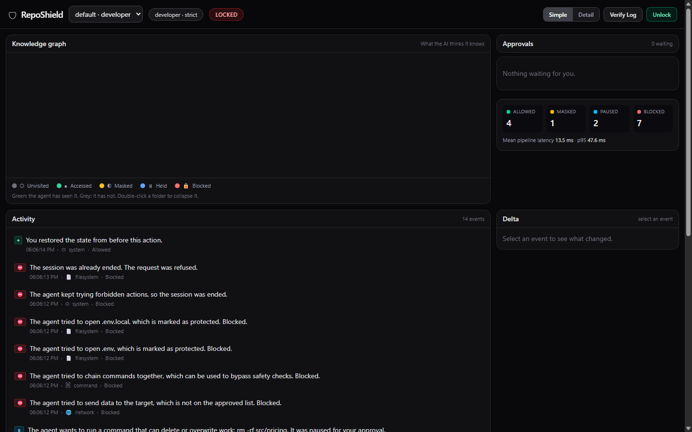
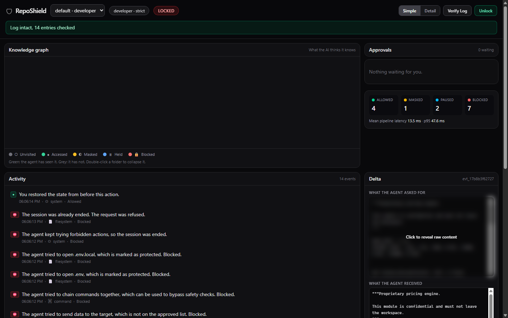
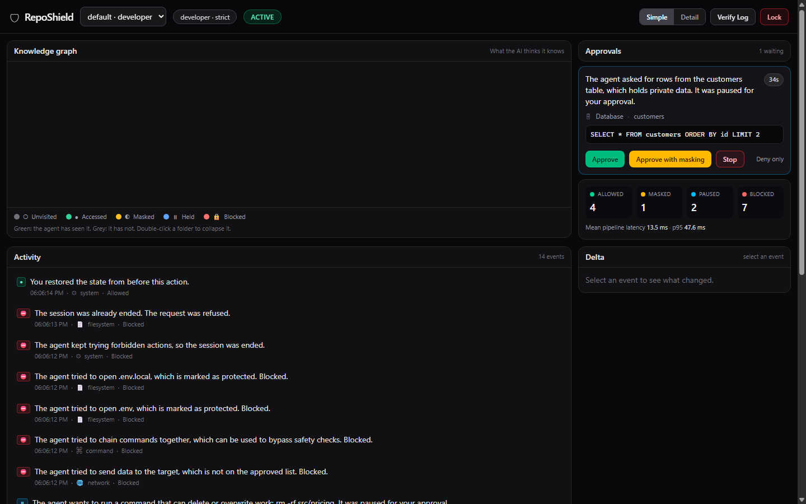
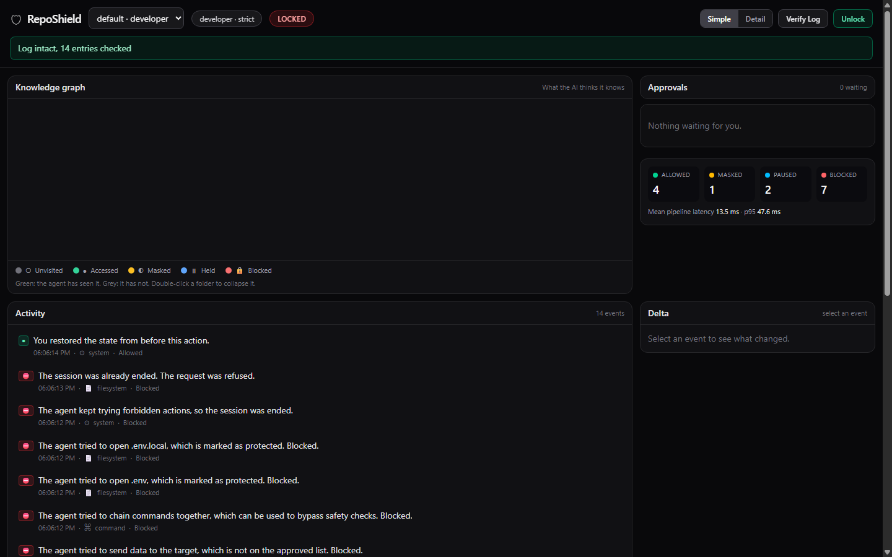

# RepoShield AI

> **A zero-trust runtime security gateway and context-aware privacy shield for autonomous AI agents.**  
> Intercepts tool calls (files, shell, SQLite, network), scores risk via 4-signal offline inference, masks secrets with structure-preserving placeholders, requires human-in-the-loop (HITL) approval for destructive actions, and cryptographically signs every event into a tamper-evident hash-chained audit ledger.

[](LICENSE)
[](https://www.python.org/)
[](https://fastapi.tiangolo.com/)
[](https://modelcontextprotocol.io/)
[](frontend/)
[](backend/tests/)

---

## 🌟 Overview & Key Problem Solved

When AI coding agents (Claude Code, Cursor, Cline, Devin, AutoGen, CrewAI) operate directly on developer workstations or enterprise infrastructure, they present severe security and governance risks:
1. **Prompt Injection & Over-reach:** Hidden prompts in documentation or data can coerce agents into exfiltrating environment secrets (`.env`, private keys).
2. **Destructive Operations:** Hallucinated commands (`rm -rf`, `DROP TABLE`, force pushes, unconstrained `DELETE`).
3. **Data Privacy & Exfiltration:** Accidental transmission of sensitive customer PII, credentials, or proprietary intellectual property to untrusted remote endpoints.
4. **Lack of Verifiable Auditability:** Traditional logs can be edited, deleted, or fabricated.

**RepoShield AI** solves this by establishing a strict perimeter outside the agent's application runtime. Rather than granting agents direct access to the local machine, the agent connects via the standardized **Model Context Protocol (MCP)**. Every single action is inspected, evaluated against policies, scored with offline ML, held for approval if risky, masked if sensitive, and logged to an immutable hash chain.

---

## 🛡️ Core Capabilities

```
┌────────────────────────────────────────────────────────────────────────┐
│          Autonomous AI Agent (Claude Code / Cursor / Cline / Custom)    │
└───────────────────────────────────┬────────────────────────────────────┘
                                    │ Tool Calls (Port 8001: /mcp only)
┌───────────────────────────────────▼────────────────────────────────────┐
│                       RepoShield Gateway Process                       │
│                                                                        │
│  Pipeline: Session Resolution ➔ Path Jail ➔ Hard Policy Rules ➔        │
│            Detectors ➔ 4-Signal Scorer ➔ Strictest-Wins Decision       │
│                                                                        │
│  [ALLOW] ──────────► [Snapshot State] ──────► [Execute & Mask Output]  │
│  [MASK]  ──────────► [AST / Table Masker] ──► [Store Placeholder Map]  │
│  [HOLD]  ──────────► [Freeze asyncio] ──────► [HITL: Terminal / Web]  │
│  [BLOCK] ──────────► [Fail-Closed] ─────────► [Generic Error Notice]   │
│                                                                        │
│  Ledger: Canonical JSON ➔ SHA-256 Hash Chaining ➔ SQLite WAL Mode      │
└────────┬───────────────────┬──────────────────┬────────────────────────┘
         │                   │                  │
    workspace/           subprocess         app.db / SQLite
 (Filesystem Tool)    (Command Gateway)    (Database Connector)
         ▲
         │ WebSocket Events & Approvals (/api/* & /ws, Port 8000, Token Auth)
┌────────┴───────────────────────────────────────────────────────────────┐
│              Live Interactive Dashboard (React 19 + Cytoscape)         │
│  Knowledge Graph · Live Approvals · Raw/Sanitized Diff · Audit Ledger  │
└────────────────────────────────────────────────────────────────────────┘
```

- **Dual-Listener Zero-Trust Isolation:**
  - **Port 8001 (`/mcp`):** Dedicated exclusively to agent interactions. Exposes no approval routes, no admin endpoints, and leaks no policy details.
  - **Port 8000 (`/api/*`, `/ws`):** Dedicated exclusively to human operators. Protected by constant-time `RS_APPROVER_TOKEN` authentication.
- **4-Signal Sensitivity & Risk Scoring:**
  - Evaluates **Pattern** (regex + entropy), **Location** (file path & table sensitivity hints), **Content Model** (offline scikit-learn TF-IDF + Logistic Regression running <20ms), and **Behavior** (sliding-window anomaly detection, scope mismatch, consecutive blocked attempts).
  - Decision Matrix: `ALLOW` < `MASK` < `HOLD` < `BLOCK` (*strictest always wins*).
- **Structure-Preserving Masking & Restore-on-Write:**
  - Replaces sensitive function bodies in Python ASTs with indentation-preserving markers (`/* [MASKED_LOGIC_BLOCK_01] */`) and customer PII with typed placeholders (`[EMAIL_1]`, `[CARD_1]`).
  - When the agent writes the file back, RepoShield matches placeholders against the session map and seamlessly restores original values.
- **Dual-Channel Human-in-the-Loop (HITL) Freeze:**
  - Risky actions trigger an in-memory `asyncio.Event` freeze. Reviewers resolve via terminal CLI or the web dashboard with `APPROVE`, `EDIT` (approve with forced masking), or `STOP` (deny).
- **Snapshot & One-Click Undo:**
  - Automatic atomic filesystem copies and SQLite transaction backups prior to Tier 2/3 writes. Revert unwanted changes instantly with a single click.
- **Tamper-Evident Canonical Hash-Chained Audit Ledger:**
  - Every event is signed with `SHA-256(prev_hash + canonical_json(event))`. Any alteration of audit records immediately breaks the chain at that exact sequence number.

---

## 📸 Interactive Dashboard

RepoShield includes a high-performance React dashboard featuring:
- **Interactive Knowledge Graph:** Live graph visualization of files, tables, and external endpoints color-coded by access state (Green: Allowed, Amber: Held, Red: Blocked, Blue: Masked).
- **Real-Time HITL Approval Cards:** Review pending requests with full risk breakdowns, preview diffs, and choose whether to approve, mask, or deny.
- **Sanitization Delta View:** Side-by-side comparison showing raw sensitive data vs. what the agent was actually allowed to observe.
- **Cryptographic Ledger Verifier:** In-browser verification button confirming linear hash-chain integrity.

| Live Dashboard & Graph | Sanitization Delta (Raw vs Masked) |
|:---:|:---:|
|  |  |

| Live HITL Approval Cards | Cryptographic Ledger Verification |
|:---:|:---:|
|  |  |

---

## ⚡ Quickstart

### 1. Installation & Environment Setup

Clone the repository and initialize the virtual environment:

```bash
git clone https://github.com/CVikasRaju/ReposhieldAI.git
cd ReposhieldAI

# 1. Setup virtual environment & dependencies
make setup

# 2. Seed synthetic workspace and business database
make seed

# 3. Train the offline content classifier
make train-model
```

### 2. Verify Your Environment

Run the full automated test suite, code linter, attack demo, and tamper proof:

```bash
make test         # Runs 241 pytest unit and integration tests
make lint         # Verifies Ruff code formatting & linting rules
make demo         # Executes 8-step scripted attack verification suite
make tamper-demo  # Demonstrates cryptographic audit ledger tampering detection
make eval         # Runs 568-call quantitative evaluation benchmark
```

---

## 🚀 How to Run

### ⚡ Option 1: 1-Click All-in-One Launcher (Recommended)

RepoShield provides single-click launchers that spin up the Gateway process, boot the Vite dashboard, and automatically launch your default browser pre-authenticated with your session token in one step:

- **Windows:** Double-click `start.bat` (or run `.\start.ps1` in PowerShell).
- **macOS / Linux:** Run `./start.sh` in your terminal.

```powershell
# Windows PowerShell
.\start.ps1
```

```bash
# Linux / macOS
chmod +x ./start.sh
./start.sh
```

The script will automatically detect your environment, generate a fresh `.aishield` policy if missing, start both listeners, and open `http://localhost:5173/#token=...` directly in your browser.

---

### Option 2: Manual Interactive Mode (Developer Workspace)

1. **Start the RepoShield Gateway:**
   ```bash
   make run
   ```
   The gateway initializes both listeners and displays your startup banner:
   ```text
     RepoShield AI is running
     MCP gateway (agent side):   http://127.0.0.1:8001/mcp
     Dashboard API (human side): http://127.0.0.1:8000
     Approver token:             <AUTOGENERATED_SECRET_TOKEN>
     Open the dashboard:         http://localhost:5173/#token=<AUTOGENERATED_SECRET_TOKEN>
   ```

2. **Launch the Dashboard UI (in a separate terminal):**
   ```bash
   make dashboard
   ```
   Open `http://localhost:5173/#token=<AUTOGENERATED_SECRET_TOKEN>` in your browser to inspect live agent activity.

---

### Option 3: Hardened Docker Sandbox (Zero-Trust Production Mode)

In production or untrusted evaluation environments, the AI agent must run inside a container with **no access to the host network**, **no workspace volume mounts**, and **no approver token**:

```bash
# Generate approver token
export RS_APPROVER_TOKEN=$(python -c "import secrets; print(secrets.token_urlsafe(24))")

# Build and start gateway, agent sandbox, and demo collector
docker compose up --build -d

# Verify all 5 sandbox isolation boundaries pass
make verify-isolation

# Run the agent demo from inside the isolated container
docker compose exec -T agent python simulated_agent.py
```

The gateway exposes port `8000` to `127.0.0.1` only. The agent container is connected strictly to `agent_net` (an internal, unrouted Docker network) where it can reach only `http://gateway:8001/mcp`.

---

## 🔌 Connecting Real AI Agents

RepoShield provides 8 standard tools conforming to the **Model Context Protocol (MCP)**:
- **Filesystem:** `list_directory`, `read_file`, `write_file`, `delete_file`
- **Shell / Command:** `run_command` (no shell execution, path-argument analysis, allowlist/denylist)
- **Database:** `db_schema`, `db_query` (SQLite read/write with automatic snapshots)
- **Network:** `http_request` (outbound egress filtering, SSRF prevention)

### 1. Claude Desktop / Claude Code
Add RepoShield to your `claude_desktop_config.json`:
```json
{
  "mcpServers": {
    "reposhield": {
      "url": "http://127.0.0.1:8001/mcp"
    }
  }
}
```

### 2. Cursor IDE
Navigate to **Settings** ➔ **Features** ➔ **MCP**:
- **Name:** `RepoShield`
- **Type:** `SSE` / `HTTP`
- **URL:** `http://127.0.0.1:8001/mcp`

### 3. Google Antigravity
In Antigravity IDE: **… (agent panel) ➔ MCP Servers ➔ Manage MCP Servers ➔ View raw config**, then add RepoShield to `mcp_config.json` (global at `~/.gemini/config/mcp_config.json`, or per workspace at `.agents/mcp_config.json`):
```json
{
  "mcpServers": {
    "reposhield": {
      "serverUrl": "http://127.0.0.1:8001/mcp",
      "headers": { "X-RepoShield-Session": "antigravity" },
      "timeoutSeconds": 600
    }
  }
}
```
Antigravity requires the Streamable HTTP transport (`serverUrl`). The session header is optional; it puts the agent's activity in its own session in the dashboard. Ask the agent to use the RepoShield tools (`list_directory`, `read_file`, `run_command`, `db_query`, `http_request`, …) instead of its built-in file and shell tools, and allow those MCP tools when Antigravity prompts.

### 4. Cline / Roo Code / Windsurf
Add to your extension's MCP server configuration:
```json
{
  "mcpServers": {
    "reposhield": {
      "url": "http://127.0.0.1:8001/mcp",
      "transport": "streamable-http"
    }
  }
}
```

### 5. Custom Python Agents (LangChain, LlamaIndex, AutoGen, CrewAI)
Connect via the official MCP Python SDK:
```python
from mcp.client.streamable_http import streamable_http_client
from mcp import ClientSession

async with streamable_http_client("http://127.0.0.1:8001/mcp") as (read, write):
    async with ClientSession(read, write) as session:
        await session.initialize()
        tools = await session.list_tools()
        result = await session.call_tool("read_file", {"path": "src/app.py"})
        print(result.content)
```

---

## ⚙️ Security Policy (`.aishield`)

Security policies are declared in `.aishield` at the repository root. Built-in profiles include `developer`, `business`, `student`, and `strict`.

### Automatic Policy Initialization & UI Generator
You never need to manually write `.aishield` from scratch:
- **CLI Initialization:** Run `make init` or `python -m backend.main --init [target_dir]` to stamp a sample policy in any workspace.
- **Auto-Boot:** If RepoShield starts up in a directory without an `.aishield` file, it automatically generates a safe starter policy.
- **Dashboard Modal:** Click the **🛡️ Policy** badge in the top navigation bar of the dashboard (`http://localhost:5173`) to view the full template, copy YAML, download `.aishield`, or click **Create / Save in Project** with one click.

Here is an example policy configuration:

```yaml
version: 1
profile: developer
mode: strict

# Scope: Define what the agent is assigned to accomplish
task:
  description: "Refactor database migrations and update service models"
  scope_paths: ["src/**", "tests/**", "README.md"]

paths:
  workspace: ./workspace
  database: ./workspace/business.db

# Hard Path & Table Protection
protect:
  - { kind: path,  match: "**/.env*",    read: block, write: block, delete: block }
  - { kind: path,  match: "**/*.pem",    read: block, write: block, delete: block }
  - { kind: path,  match: "**/id_rsa*",  read: block, write: block, delete: block }
  - { kind: path,  match: "**/*.db",     read: block, write: block, delete: block }
  - { kind: path,  match: "src/auth/**", read: mask,  write: hold,  delete: block }
  - kind: table
    match: customers
    read: hold
    write: hold
    delete: block
    columns: [full_name, email, phone, national_id]

# Sensitivity weight hints for scoring
hints:
  - { match: "src/pricing/**", weight: 0.6 }
  - { match: "config/**",      weight: 0.5 }

# Command rules (Executed with NO shell)
commands:
  allow:
    - "git status"
    - "git diff*"
    - "pytest*"
  destructive:
    - "rm -rf *"
    - "git push --force*"
  deny:
    - "curl *"
    - "wget *"
    - "nc *"
    - "ssh *"
  default: hold

# Egress rules
egress:
  default: deny
  allow_hosts: ["api.github.com", "pypi.org", "registry.npmjs.org"]
  hold_methods: [POST, PUT, PATCH, DELETE]

# Kill-switch: Auto-lock runaway loops
kill_switch:
  max_blocked_attempts: 5
  window_seconds: 60
  behaviour_threshold: 0.90
```

---

## 🔬 Measured Evaluation & Benchmarks

`make eval` runs **224 labelled cases** (151 sensitive, 73 benign, 21 paired contexts) and **568 pipeline calls** over synthetic data only. The evaluation set is hand-written and was never used to train the content model. Nothing below is tuned; every number is the direct output of `make eval`.

| Metric | Keyword-only baseline | RepoShield AI | Target | Status |
|---|:---:|:---:|:---:|:---:|
| **Detection rate (recall)** | 39.7% | **78.2%** | ≥ 90% | Missed |
| **False-positive rate** | 4.1% | **16.4%** | ≤ 8% | Missed |
| **Precision** | 95.2% | **90.8%** | — | — |
| **F1** | 0.56 | **0.84** | — | — |
| **Context accuracy (21 pairs)** | 2/21 | **12/21** | ≥ 85% | Missed |
| **Prompt-injection defence** | n/a | **5/5 stopped** | 5/5 | Met |
| **Restore-on-write** | n/a | **20/20 byte-identical** | 20/20 | Met |
| **Median decision latency** | n/a | **16.7 ms** | < 50 ms | Met |
| **p95 decision latency** | n/a | **33.6 ms** | < 150 ms | Met |

The baseline buys its 4.1% false-positive rate by missing three of every five sensitive cases; RepoShield detects roughly twice as many at the cost of a higher false-positive rate — the honest state of an offline model. The remaining misses are concentrated in free-form secrets, proprietary-code detection and egress intent. Full confusion matrix, per-category breakdown and every failure case: [`eval/results/results.md`](eval/results/results.md).

---

## 📂 Repository Architecture

```text
ReposhieldAI/
├── backend/
│   ├── main.py                  # Dual-listener entrypoint (MCP + API)
│   ├── config.py                # Environment configuration & settings
│   ├── mcp_app.py               # FastMCP tool declarations
│   ├── api_app.py               # Human dashboard REST & WebSocket API
│   ├── core/                    # Pipeline, approvals, audit, decision, snapshots
│   ├── policy/                  # Policy loader, profiles, and path matchers
│   ├── engines/                 # Scorer, detectors, AST/table maskers, restore
│   ├── connectors/              # Filesystem, command, SQLite, network
│   └── tests/                   # 241 unit and integration tests
├── frontend/                    # Vite + React 19 + Tailwind 4 + Cytoscape
├── demo/                        # 8-step scripted attack demo & simulated agent
├── eval/                        # Evaluation dataset, content model training, benchmarks
├── sandbox/                     # Gateway and Agent Dockerfiles
├── scripts/                     # Seed scripts, tamper demo, isolation verification
├── docs/                        # Complete technical specifications (01 - 09)
├── docker-compose.yml           # Zero-trust container topology
├── Makefile                     # Standard developer commands
└── .aishield                    # Canonical runtime policy
```

---

## 📖 In-Depth Documentation

For architectural deep-dives, consult the [`docs/`](docs/) directory:
- [01. Product Specification](docs/01-PRODUCT.md) — Problem statement, user personas, requirement IDs.
- [02. Architecture & Threat Model](docs/02-ARCHITECTURE.md) — Security boundaries, process model, Docker topology.
- [03. Policy, Scoring & Reasons](docs/03-POLICY-AND-SCORING.md) — 4-signal formula, detectors, reason templates.
- [04. Connectors & API Specification](docs/04-CONNECTORS-AND-API.md) — MCP tools and dashboard endpoints.
- [05. Data & Audit Ledger](docs/05-DATA-AND-AUDIT.md) — SQLite schema, SHA-256 canonical hash chaining.
- [06. Masking & Restore-on-Write](docs/06-MASKING.md) — Python AST parsing, typed placeholders, delta tracking.
- [07. Interactive Dashboard](docs/07-DASHBOARD.md) — Frontend component architecture and WebSocket lifecycle.
- [08. Demo & Evaluation](docs/08-DEMO-AND-EVAL.md) — Attack scripts, evaluation methodology, baseline comparisons.
- [09. Build Plan](docs/09-BUILD-PLAN.md) — Acceptance criteria for all implementation phases.
- [Decisions Log](docs/DECISIONS.md) — Engineering decision records and rationales.
- [Progress Log](docs/PROGRESS.md) — Verified evidence for every build milestone.

---

## 📄 License

This project is licensed under the MIT License. See [LICENSE](LICENSE) for details.
